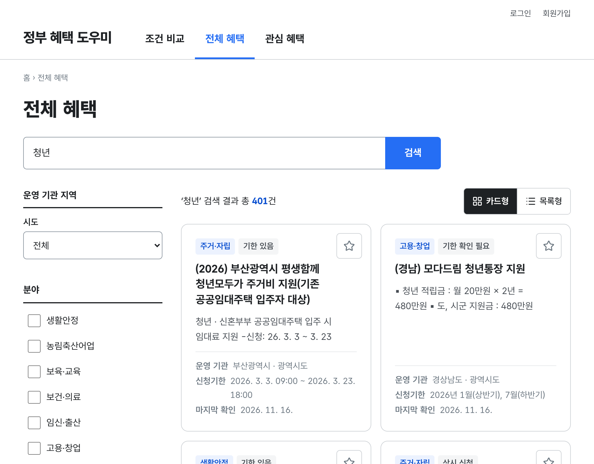
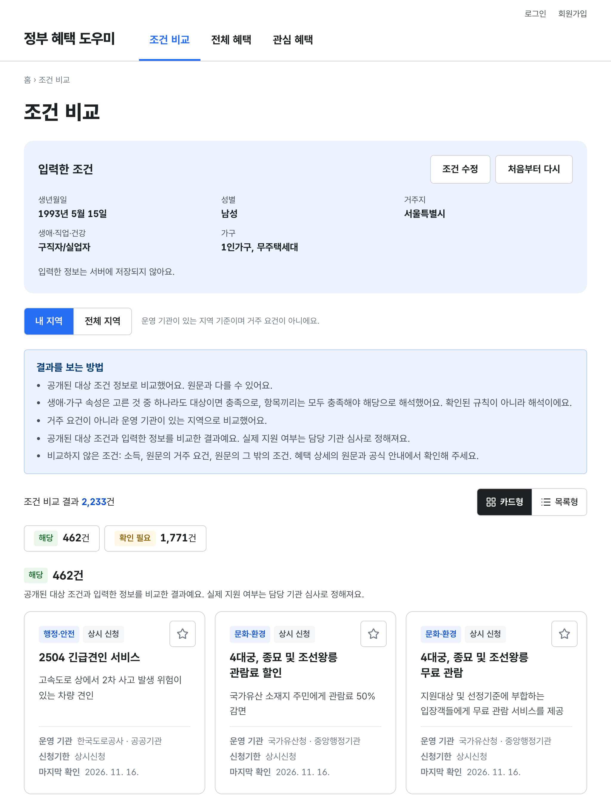
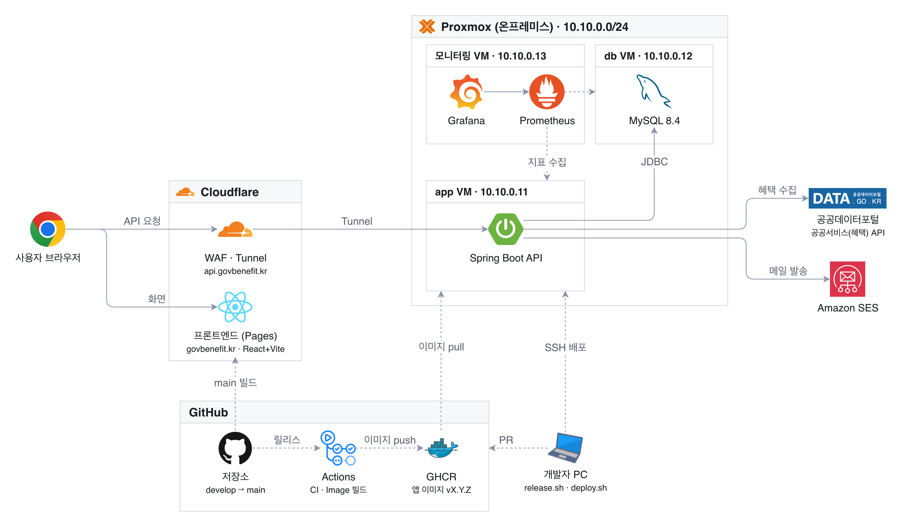

# 정부 혜택 도우미

중앙부처·지자체·공공기관의 혜택을 한곳에서 검색하고, 내 조건과 비교해 볼 수 있는 웹 서비스입니다. 공공데이터포털의 [공공서비스(혜택) 정보](https://www.data.go.kr/data/15113968/openapi.do)를 매일 수집해 보여 줍니다.

서비스 주소: **<https://govbenefit.kr>**

**혜택 검색**



**조건 비교 결과**



## 주요 기능

- **혜택 검색**: 혜택을 키워드, 분야, 운영 기관 지역으로 찾습니다.
- **상세 확인**: 지원 내용, 대상, 신청 방법, 기한을 보고 공식 신청처로 이동합니다.
- **조건 비교**: 가입하지 않고 생년월일, 거주지, 생애·가구 상황을 입력하면 공개된 대상 조건과 비교합니다. 결과는 `해당`과 `확인 필요`로 나뉘고, 직접 확인해야 할 조건을 함께 보여 줍니다.
- **프로필과 관심 혜택**: 가입하면 입력한 조건을 저장해 두고, 관심 있는 혜택을 모아 봅니다.
- **새 혜택 알림**: 알림을 켜면 내 조건에 맞는 혜택이 새로 수집됐을 때 매일 08:00에 메일로 묶어 받습니다.

조건 비교는 공개된 대상 조건과 입력한 정보를 비교한 결과입니다. 실제 지원 여부는 담당 기관의 심사로 정해집니다.

## 시스템 아키텍처



## 기술 스택

| 구분 | 기술 |
| --- | --- |
| 백엔드 | Java 21, Spring Boot 4.1.1, Spring Data JPA, Spring Security, Flyway |
| DB | MySQL 8.4 |
| 프론트 | React 19, TypeScript 5, Vite 8, React Router 8 (Node 26) |
| 테스트 | JUnit, Testcontainers(MySQL) |
| 배포 | Docker Compose, GitHub Actions, GHCR, Cloudflare Pages·Tunnel |
| 운영 | Prometheus, Grafana, k6, Amazon SES |

## 로컬 실행

Docker, JDK 21, Node 26이 필요합니다. `.env` 없이 기본값으로 실행됩니다.

```bash
# 1. MySQL
docker compose -f docker-compose.local.yml up -d

# 2. API: http://localhost:8080 (API 문서는 /swagger-ui.html)
cd backend
SPRING_PROFILES_ACTIVE=local ./gradlew bootRun

# 3. 프론트: http://localhost:3000 (새 터미널에서)
cd frontend
npm ci
npm run dev
```

- 처음에는 DB가 비어 있어 혜택이 0건입니다. 공공데이터포털에서 받은 인증키(Decoding)를 `backend/.env`의 `GOV24_SERVICE_KEY`에 넣고 `SPRING_PROFILES_ACTIVE=local,collect ./gradlew bootRun`으로 띄우면 기동할 때 한 번 수집합니다.
- `local` 프로필은 메일을 보내지 않습니다. 가입 인증번호와 비밀번호 재설정 링크는 API 로그에 남습니다.
- 테스트는 `backend/`에서 `./gradlew test`로 실행합니다. Testcontainers가 MySQL을 띄우므로 Docker가 필요합니다.

## 문서

기획, 요구사항, 기술 결정, 운영 절차는 [`docs/`](docs/README.md)에 있습니다. 어떤 문서부터 읽을지는 [개발 문서 안내](docs/README.md)에 정리했습니다.
